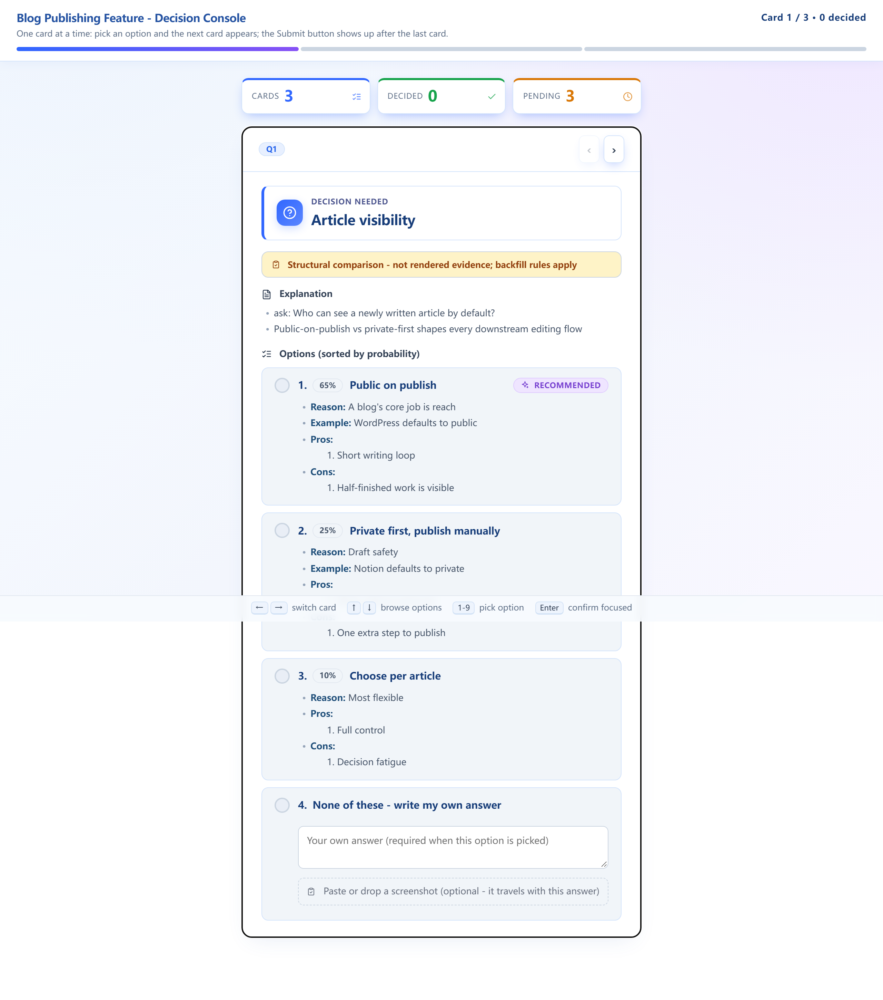
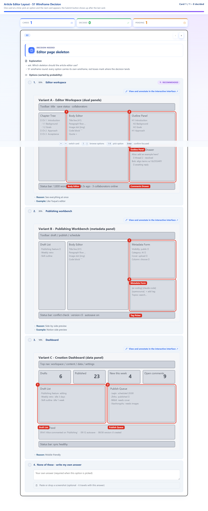
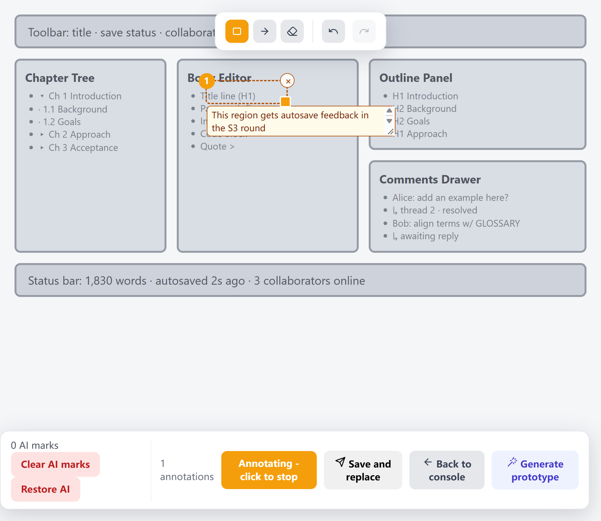
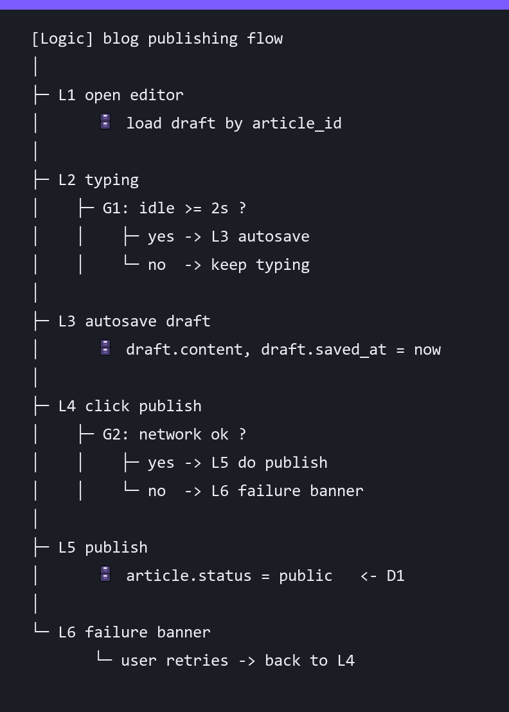
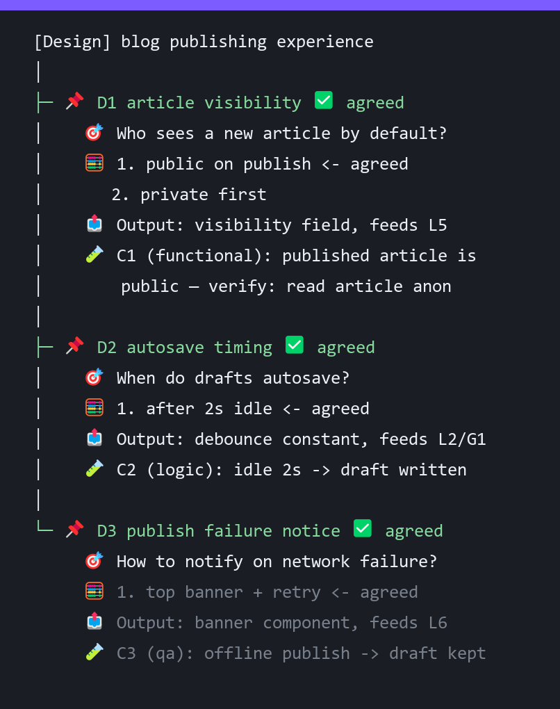

# Align With Me


One job: get **aligned** with your agent before a single line of code is written. Run `/align-with-me` and it composes two skills - `/grill-tree` interviews you relentlessly, in rounds, until every branch of your plan is settled (as a decision tree), and `/domain-modeling` turns the settled decisions into shared docs (ADR's, a glossary) as you go.

Just want the interview? `/grill-tree` also works standalone.

## Why This Skill Exists

> "Plans are worthless, but planning is everything."
>
> Dwight D. Eisenhower

**The Problem.** The most common failure mode in AI-assisted development is misalignment. You *think* the agent knows what you want. Then you see what it built - and realize it never understood you at all. Everything downstream inherits that first misunderstanding: the spec, the tickets, the code.

**The Fix.** An alignment interview. Not a form to fill in, not a template to own - an interactive grilling session that works your plan as a **decision tree**: every decision branches into the decisions that hang off it, and nothing gets asked before its prerequisites are settled.

## How It Works

`/grill-tree` works the tree in **rounds**. Each round asks the whole **frontier** - every decision whose prerequisites are already settled, each with a recommended answer - then waits. Your answers reshape the tree and push the frontier outward. Facts are looked up, never asked; decisions are always yours.

Every round routes through one table into one of four branch forms:

| Branch | What it covers | Channel |
|---|---|---|
| Design | Roles, trade-offs, architecture, parameters | Decision tree, question rounds |
| Logic | If/then, loops, state changes, calculations, hand-offs | Logic tree, `.xlsx` evidence |
| UI / UX | Layout, components, flow, visual style | A local **decision console** (`serve_decision.py`): one card per decision, rendered evidence, write-ins, screenshots, annotations |
| Doc | Wording changes to an existing document | Question tool + diff |

The session closes only when the frontier is empty and nothing is left silently assumed. The closing plan is presented once, confirmed by you, and only then handed to the execution workflow.

## The Three UI/UX Highlights

### 1. A console that showcases every decision

UI/UX rounds run through a **local decision console**: one card per decision, options sorted by probability with a recommendation, keyboard-first (1-9 / arrows / Enter), and a live alignment table on top:



### 2. Wireframe evidence, drawn for you

Every option carries **its own wireframe** - the console draws numbered red evidence boxes that show exactly where the decision lands. You decide on the region, never on a vague text description:



### 3. Annotate and caption, then send it back

You can edit the real page directly: draw boxes, write captions, hit **Save and replace** - your annotation replaces that option's evidence and rides back with the answer:



## The Trees

### Logic tree

Logic questions (if/then, state changes, conditions) render as an ASCII tree with evidence anchors - every node traces to where it lands in code:



### Decision tree

Design decisions land as decision nodes with the chosen option, what it settles, and a paired acceptance criterion:



## Installation (30-second setup)

### 1. Install the dependency

`/grill-tree` finishes by handing the confirmed plan to skills from [mattpocock/skills](https://github.com/mattpocock/skills) - install that repo first.

**Claude Code**

```
claude plugin install mattpocock-skills@claude-plugins-official
```

**Codex**

```
codex plugin marketplace add mattpocock/skills
codex plugin add mattpocock-skills@mattpocock
```

**GitHub Copilot** (CLI and VS Code)

```
copilot plugin marketplace add mattpocock/skills
copilot plugin install mattpocock-skills@mattpocock
```

**Any other agent**

```
npx skills@latest add mattpocock/skills -a <agent>  # cursor, opencode, devin, windsurf, amp, pi; omit -a to choose
```

### 2. Install this repo

**Claude Code** (plugin, updates itself)

```
claude plugin marketplace add jacksang6/align-with-me
claude plugin install align-with-me@jacksang6
```

**Any other agent, or editable files** (manual updates)

```
npx skills@latest add jacksang6/align-with-me -a <agent>
```

When the installer asks which skills to take, include both `align-with-me` and `grill-tree`.

### 3. Run `/align-with-me`

Bring a plan, a design, an interface, or just an idea. Answer the rounds. Confirm the closing plan - the docs grow alongside it. (Or run `/grill-tree` for the interview alone.)

## Reference

### Skills in this repo

**User-invoked**

- **align-with-me**: The orchestrator. Composes `/grill-tree` + `/domain-modeling` into one alignment session: interview first, docs (ADR's, glossary) as you go. Answering style: short sentences, simple words, consistent terms - ASD-STE100-inspired.
- **grill-tree**: Grill the user relentlessly about a plan, decision, or idea until a shared understanding is reached - mapped as a decision tree with design, logic, UI/UX and doc branches. UI rounds run a local decision console with rendered evidence and annotations.

### Dependencies (provided by mattpocock/skills)

| Skill | Used for |
|---|---|
| `/domain-modeling` | `align-with-me` runs it alongside the interview to build the glossary and ADR's |
| `/ask-matt` | `grill-tree` invokes it at closing time, after you confirm the plan, to recommend the execution path |
| `/to-spec` | Turn the confirmed plan into a spec |
| `/to-tickets` | Break the spec into tracer-bullet tickets |
| `/implement-spec` | Implement the whole spec on one integration branch |

## Hacking on it

Small, composable, and meant to be adapted. `AGENTS.md` holds the maintainer rules; `scripts/check_skill.py` is the maintainer check - run it after every change.

## License

[MIT](LICENSE)
