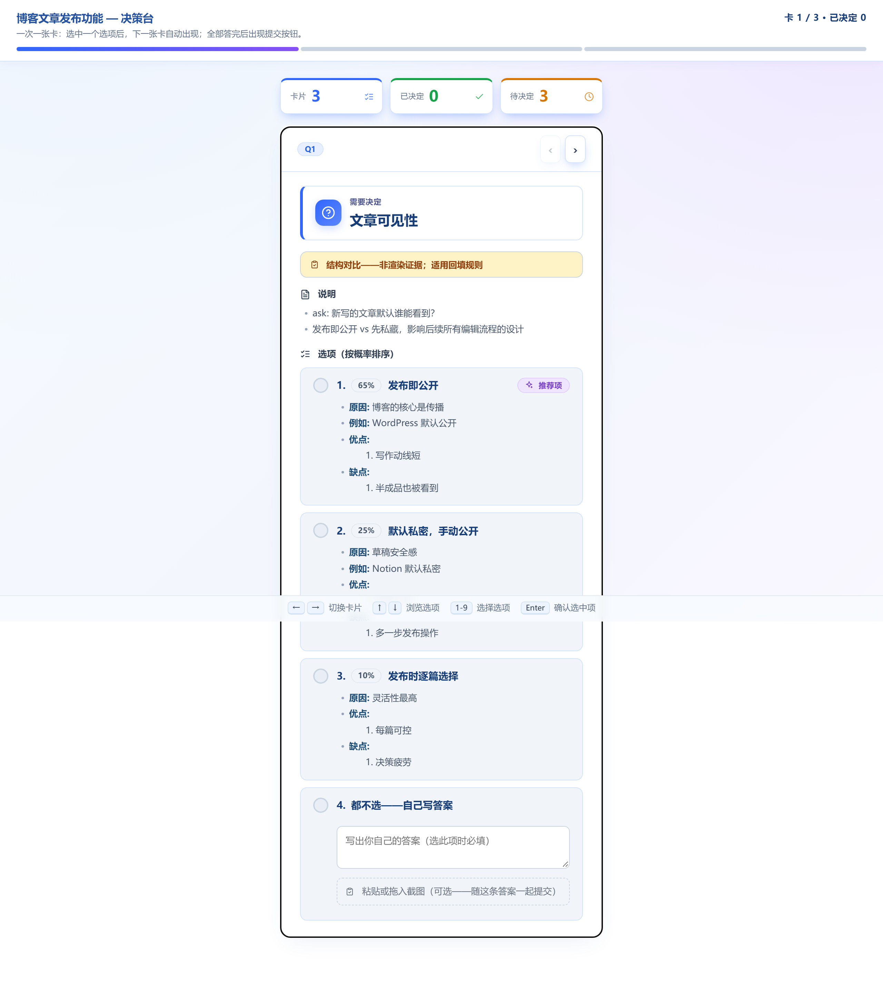

# 你的 AI 总做错东西？问题不在它，在你没"烤"它

> 你说"给文章页加个搜索框"，它给你在侧边栏塞了个全局搜索。
> 你说"优化一下加载"，它把你的首屏缓存策略整个重写了。
>
> 这不是 AI 笨。这是**错位** —— 你以为它懂了，它以为它懂了。

## 一个真实场景

把这段话丢给任何一个 AI 编码助手：

> "帮我给博客加文章发布功能，要能存草稿。"

十分钟后你得到一个能跑的东西。然后你发现问题：

- 你想的草稿是**自动保存**，它做的是手动 Ctrl+S
- 你想的发布是**默认公开**，它做成了默认私密还要二次确认
- 断网时发布失败，它直接把你的草稿**清空了**

每一处都不大，但每一处都要返工。返工的时间，远超你当初"多说两句"的成本。

这就是 AI 时代软件开发的第一失败模式：**不是代码写不出来，是开头就没对齐**。

## 现有方案的困境

为了解决这个问题，市面上有一堆"流程框架"—— GSD、BMAD、Spec-Kit……它们的思路是：**接管你的整个流程**，从头到尾替你安排。

问题是：接管你的流程 = 拿走你的控制权。流程里有个环节不合你的场景？你要跟框架搏斗。

Matt Pocock（Total TypeScript 作者）在他的 [skills 仓库](https://github.com/mattpocock/skills)里说过一个观点，我很认同：好的技能应该**小、可改、可组合**，而不是一个大而全的流程。

## 我做了一个技能：grill-tree

[align-with-me](https://github.com/jacksang6/align-with-me) 里的 `/grill-tree`，就做一件事：**在写第一行代码之前，像拷问一样把你问清楚**。

它的工作方式：

1. **把你的需求画成一棵决策树** —— 每个决策分叉出下一层决策
2. **一轮一轮地问** —— 每轮只问"前提已确定"的问题，不问你还没法回答的
3. **每个问题都带推荐答案** —— 不是开放式问卷，是"我建议 65% 选 A，理由如下"，你确认或改
4. **问完为止** —— 直到没有任何"双方默认以为一致"的地方

## 真正的差异：UI 决策控制台

问到界面和交互，事情变得有趣了。文字描述界面方案，双方想象出来的东西往往不一样。

grill-tree 会**起一个本地决策控制台** —— 一个真实的网页，长这样：



- 每个决策一张卡片，选项按推荐概率排序
- 每个选项带**真实的对比截图**（不是文字描述"大概长这样"）
- 键盘 1-9 选选项、方向键切卡片、Ent.. 确认，全程手不离键盘
- 每轮结束自动记录成决策日志

你看到的每一个选项，都是**渲染出来的真实状态**，不是 AI 对界面的转述。这一下就消灭了"我以为的蓝色和你以为的蓝色不是一个蓝"的问题。

## 四种问题，四种问法

| 你在纠结什么 | 它怎么问 |
|---|---|
| 谁做什么、权限怎么分 | 设计树，表格对齐 |
| 如果/那么、流程、状态变化 | 逻辑树，ASCII 树图 + Excel 证据 |
| 界面长什么样、交互怎么走 | 决策控制台，真实渲染截图 |
| 改个文档措辞 | 直接给 diff 让你选 |

## 问完了呢？

全部对齐后，它会生成收尾计划让你确认，然后接 Matt 的交付链：`/to-spec` → `/to-tickets` → `/implement-spec`。 grill-tree 管"想清楚"，Matt 的链路管"做出来"。

所以它不是替代 Matt 的 skills，是站在它上面的**前置环节** —— 这也是为什么安装它之前要先装 [mattpocock/skills](https://github.com/mattpocock/skills)。

## 30 秒装起来

```bash
# 1. 先装依赖
npx skills@latest add mattpocock/skills -a claude-code

# 2. 再装本仓库
npx skills@latest add jacksang6/align-with-me -a claude-code

# 3. 对 AI 说：/align-with-me
```

支持 Claude Code、Codex、Cursor、Gemini CLI 等 75+ agent（`-a` 换名字即可）。

## 最后说句实话

这个技能治不了"你根本不知道自己要什么"。但它能把"你其实知道、只是没说清楚"的部分，一个不漏地问出来。

**装一次，下次开工前先跑 `/align-with-me`。你省下的返工时间会超过你回答问题花的时间。**

---

*仓库地址：[github.com/jacksang6/align-with-me](https://github.com/jacksang6/align-with-me)（MIT，欢迎 PR）*
*本文所有截图来自技能真实运行的服务器，非示意图。*
